# 📋 Master Kumpulan Semua Diagram Mermaid (All-in-One)
### Sistem Informasi Work Order & Tracking Progress — PT Alexander Cipta Karya (SRS-BUBUT 2026)

> **💡 Petunjuk Cepat Import ke Draw.io:**
> 1. Buka [draw.io](https://app.diagrams.net/).
> 2. Klik menu **Arrange** > **Insert** > **Advanced** > **Mermaid**.
> 3. Salin (*copy*) salah satu blok kode Mermaid di bawah ini dan tempel (*paste*) ke Draw.io.
> 4. Klik **Insert**.

---

## 📑 Daftar Isi Cepat (Klik untuk Langsung Lompat ke Diagram)

1. [01. Use Case Diagram](#01-use-case-diagram)
2. [02. Class Diagram (Arsitektur MVC Laravel)](#02-class-diagram-arsitektur-mvc-laravel)
3. [03. Context Diagram (DFD Level 0)](#03-context-diagram-dfd-level-0)
4. [04. Entity Relationship Diagram (ERD Database MySQL)](#04-entity-relationship-diagram-erd-database-mysql)
5. **Activity Diagrams (7 Alur Lengkap)**:
   - [5.1 Activity Diagram: Melakukan Login](#51-activity-diagram-melakukan-login)
   - [5.2 Activity Diagram: Melakukan CRUD Work Order](#52-activity-diagram-melakukan-crud-work-order)
   - [5.3 Activity Diagram: Mengelola Progress](#53-activity-diagram-mengelola-progress)
   - [5.4 Activity Diagram: Melihat Progress (Pelanggan)](#54-activity-diagram-melihat-progress-pelanggan)
   - [5.5 Activity Diagram: Mencari Work Order](#55-activity-diagram-mencari-work-order)
   - [5.6 Activity Diagram: Mengenerate QR (Inklusi)](#56-activity-diagram-mengenerate-qr-inklusi)
   - [5.7 Activity Diagram: Membuat Nota Pembayaran](#57-activity-diagram-membuat-nota-pembayaran)
6. **Sequence Diagrams (7 Interaksi Lengkap)**:
   - [6.1 Sequence Diagram: Melakukan Login](#61-sequence-diagram-melakukan-login)
   - [6.2 Sequence Diagram: Melakukan CRUD Work Order & Auto QR di Awal](#62-sequence-diagram-melakukan-crud-work-order--auto-qr-di-awal)
   - [6.3 Sequence Diagram: Mengelola Progress](#63-sequence-diagram-mengelola-progress)
   - [6.4 Sequence Diagram: Melihat Progress (Pelanggan)](#64-sequence-diagram-melihat-progress-pelanggan)
   - [6.5 Sequence Diagram: Mencari Work Order](#65-sequence-diagram-mencari-work-order)
   - [6.6 Sequence Diagram: Mengenerate QR Code (Inklusi Otomatis Work Order)](#66-sequence-diagram-mengenerate-qr-code-inklusi-otomatis-work-order)
   - [6.7 Sequence Diagram: Membuat Nota Pembayaran](#67-sequence-diagram-membuat-nota-pembayaran)

---

## 01. Use Case Diagram

Diagram Use Case memodelkan batasan sistem, 4 kelas pengguna/aktor, dan relasi `<<include>>` serta `<<extend>>` sesuai Bab 3.1 & 3.2 SRS.

### 🌟 Opsi A: Format PlantUML (Direkomendasikan di Draw.io untuk Stickman Otomatis)
> **Cara Pakai di Draw.io:** Menu **Arrange** > **Insert** > **Advanced** > **PlantUML**. Paste kode di bawah, lalu klik **Insert**. Seluruh aktor seketika berwujud **Stickman (UML Actor)** asli bawaan Draw.io!

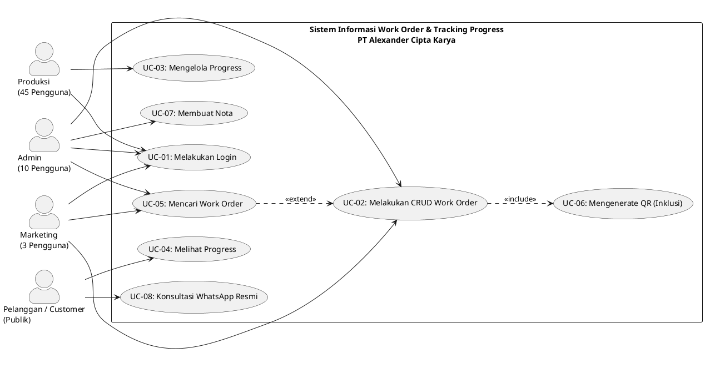

---

### 🌟 Opsi B: Format Mermaid Resmi Use Case (`usecase-beta` dengan Keyword `actor`)
> **Cara Pakai di Draw.io:** Menu **Arrange** > **Insert** > **Advanced** > **Mermaid**.

```mermaid
usecase-beta
    direction LR

    actor Admin("Admin")
    actor Marketing("Marketing")
    actor Produksi("Produksi")
    actor Customer("Pelanggan")

    systemBoundary "Sistem Informasi Work Order & Tracking Progress PT Alexander Cipta Karya"
        UC1("UC-01: Melakukan Login")
        UC2("UC-02: Melakukan CRUD Work Order")
        UC3("UC-03: Mengelola Progress")
        UC4("UC-04: Melihat Progress")
        UC5("UC-05: Mencari Work Order")
        UC6("UC-06: Mengenerate QR Code")
        UC7("UC-07: Membuat Nota")
        UC8("UC-08: Konsultasi WhatsApp")
    end

    Admin --> UC1
    Admin --> UC2
    Admin --> UC5
    Admin --> UC7

    Marketing --> UC1
    Marketing --> UC2
    Marketing --> UC5

    Produksi --> UC1
    Produksi --> UC3

    Customer --> UC4
    Customer --> UC8

    UC2 ..> : include UC6
    UC2 ..> : extend UC5
```

---

### 🌟 Opsi C: Format Mermaid Flowchart (Visual Ikon Orang)

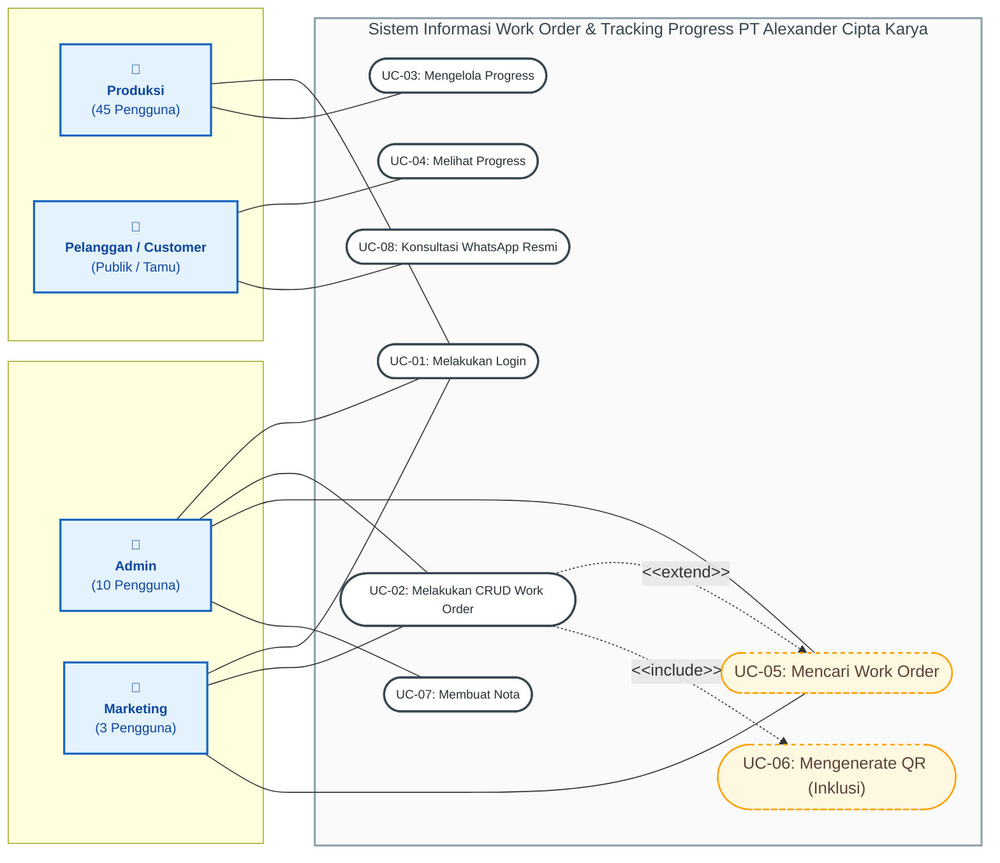

---

## 02. Class Diagram (Arsitektur MVC Laravel)

Diagram Kelas memodelkan struktur berorientasi objek sistem berbasis arsitektur MVC (Model-View-Controller) pada kerangka kerja Laravel (PHP) sesuai Bab 4.1 dan Bab 4.4 SRS.

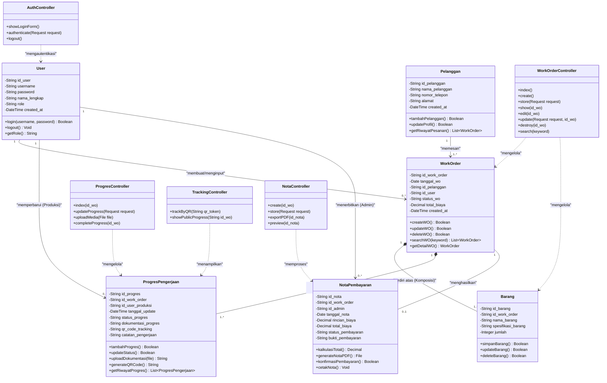

---

## 03. Context Diagram (DFD Level 0)

Diagram Konteks menggambarkan batasan sistem, entitas eksternal (*terminator*), dan aliran data masuk/keluar (*input/output data flows*) sesuai Bab 1.2, 4.1, dan 4.2 SRS.

```mermaid
flowchart TB
    %% Entitas Eksternal (Terminator)
    subgraph Pengguna_Internal ["Pengguna Internal Perusahaan"]
        Admin["Admin Bengkel"]
        Marketing["Tim Marketing"]
        Produksi["Operator Produksi"]
    end

    subgraph Pihak_Eksternal ["Pengguna & Layanan Eksternal"]
        Pelanggan["Pelanggan / Customer"]
        WhatsAppAPI["WhatsApp Official API Gateway"]
    end

    %% Entitas Sentral (Sistem)
    SistemCentral(("0.0<br/><b>Sistem Informasi Work Order<br/>& Tracking Progress</b><br/>PT Alexander Cipta Karya"))

    %% Aliran Data Admin
    Admin -->|1. Data Login Kredensial<br/>2. Data Pengelolaan WO (CRUD)<br/>3. Kata Kunci Pencarian WO<br/>4. Data Rincian Biaya & Konfirmasi Nota| SistemCentral
    SistemCentral -->|1. Status Login & Hak Akses<br/>2. Daftar & Detail Data WO<br/>3. Hasil Filter Pencarian WO<br/>4. Dokumen Nota Pembayaran (PDF/Print)| Admin

    %% Aliran Data Marketing
    Marketing -->|1. Data Login Kredensial<br/>2. Data Pelanggan & WO Baru/Edit<br/>3. Kata Kunci Pencarian WO| SistemCentral
    SistemCentral -->|1. Status Login & Hak Akses<br/>2. Daftar & Detail Data WO<br/>3. Berkas Gambar / Link QR Code Tracking| Marketing

    %% Aliran Data Produksi
    Produksi -->|1. Data Login Kredensial<br/>2. Pembaruan Status Progres Kerja<br/>3. Berkas Foto / Dokumentasi Pengerjaan<br/>4. Konfirmasi Penyelesaian Pekerjaan| SistemCentral
    SistemCentral -->|1. Status Login & Hak Akses<br/>2. Daftar WO yang Sedang Dikerjakan<br/>3. Notifikasi Berhasil Update & Generate QR| Produksi

    %% Aliran Data Pelanggan
    Pelanggan -->|1. Scan QR Code Tracking / Akses Link Unik<br/>2. Klik Tombol Konsultasi WhatsApp| SistemCentral
    SistemCentral -->|1. Informasi Status Progres & Foto Dokumentasi<br/>2. Tampilan Rincian Biaya & Nota Pembayaran<br/>3. Redireksi Tautan ke Layanan WhatsApp| Pelanggan

    %% Aliran Layanan WhatsApp
    SistemCentral -->|Tautan Pesan Konsultasi Berisi No. Resmi| WhatsAppAPI

    %% Styling Warna dan Bentuk
    classDef systemProcess fill:#E3F2FD,stroke:#1565C0,stroke-width:3px,font-size:14px,color:#0D47A1;
    classDef internalEntity fill:#FFF3E0,stroke:#E65100,stroke-width:2px,font-size:12px,font-weight:bold,color:#BF360C;
    classDef externalEntity fill:#E8F5E9,stroke:#2E7D32,stroke-width:2px,font-size:12px,font-weight:bold,color:#1B5E20;

    class SistemCentral systemProcess;
    class Admin,Marketing,Produksi internalEntity;
    class Pelanggan,WhatsAppAPI externalEntity;
```

---

## 04. Entity Relationship Diagram (ERD Database MySQL)

Diagram Hubungan Entitas memodelkan skema basis data relasional sistem (*MySQL/XAMPP*) berdasarkan 18 atribut Kebutuhan Data (Bab 4.1 SRS).

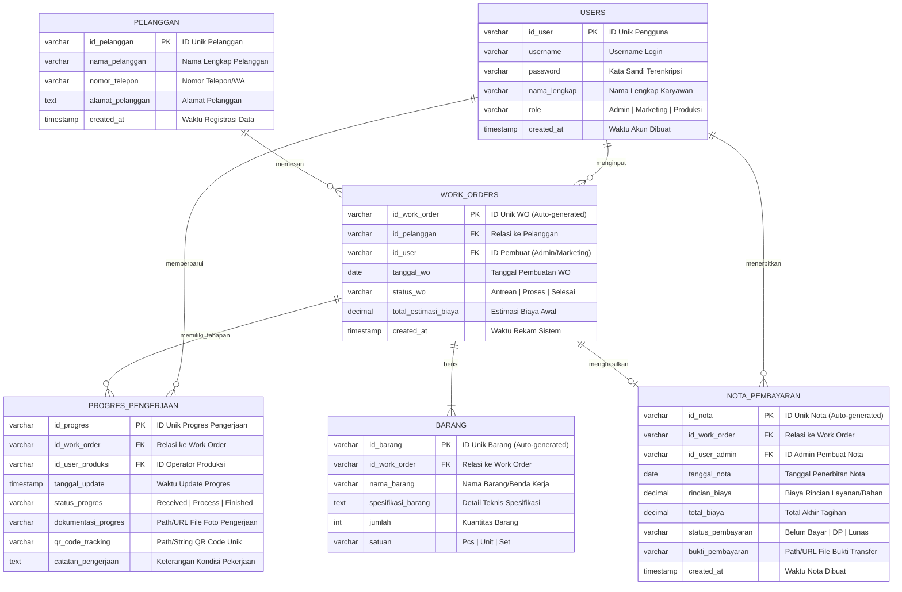

---

## 5. Kumpulan Activity Diagram (Bab 3.3 SRS)

### 5.1 Activity Diagram: Melakukan Login

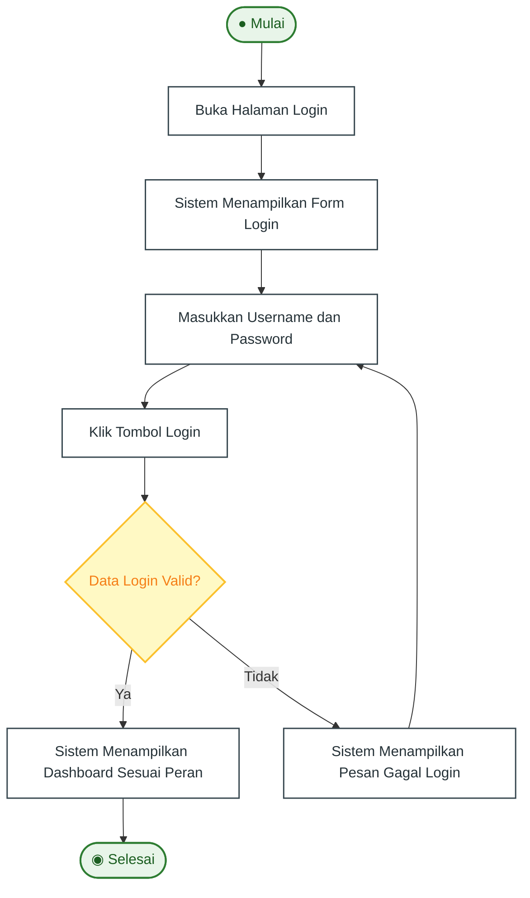

---

### 5.2 Activity Diagram: Melakukan CRUD Work Order

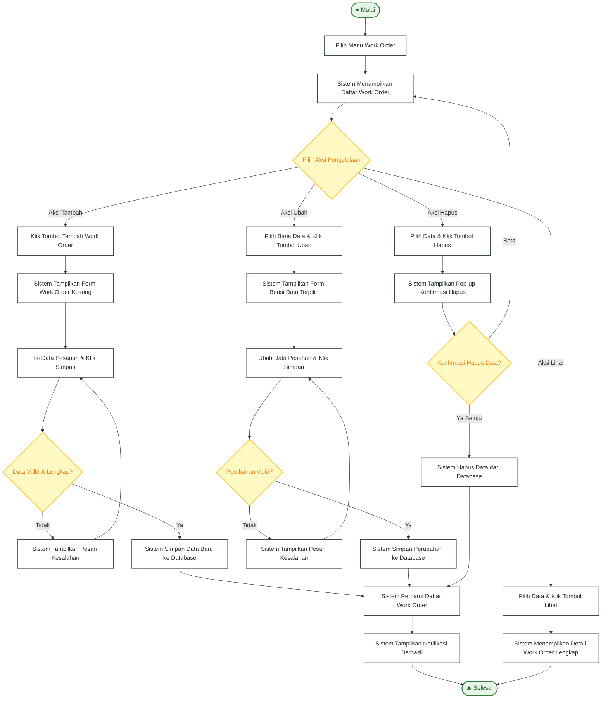

---

### 5.3 Activity Diagram: Mengelola Progress

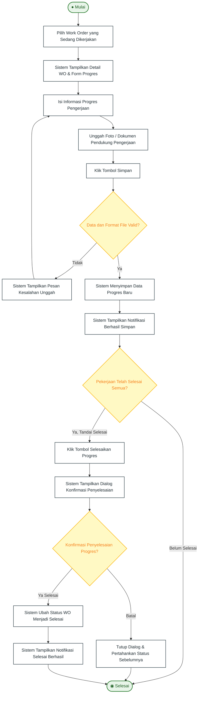

---

### 5.4 Activity Diagram: Melihat Progress (Pelanggan)

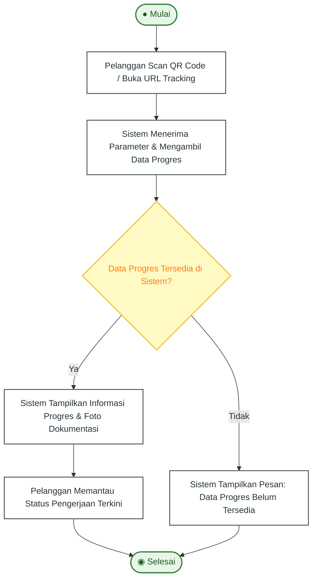

---

### 5.5 Activity Diagram: Mencari Work Order

```mermaid
flowchart TD
    Start([● Mulai]) --> A1[Masukkan Kata Kunci Pencarian Pada Kolom Input<br/>(Contoh: ID Work Order / Nama Pelanggan)]
    A1 --> S1[Sistem Memfilter Data Work Order Sesuai Kata Kunci]
    S1 --> S2{Data Sesuai Ditemukan?}
    
    S2 -->|Ya| S3[Sistem Menampilkan Daftar Hasil Pencarian yang Relevan]
    S3 --> EndNode([◉ Selesai])
    
    S2 -->|Tidak| S4[Sistem Menampilkan Pesan Peringatan: Data Tidak Ditemukan]
    S4 --> EndNode

    classDef startEnd fill:#E8F5E9,stroke:#2E7D32,stroke-width:2px,color:#1B5E20;
    classDef action fill:#FFFFFF,stroke:#37474F,stroke-width:1.5px,color:#263238;
    classDef decision fill:#FFF9C4,stroke:#FBC02D,stroke-width:2px,color:#F57F17;
    
    class Start,EndNode startEnd;
    class A1,S1,S3,S4 action;
    class S2 decision;
```

---

### 5.6 Activity Diagram: Mengenerate QR (Inklusi Otomatis Work Order)

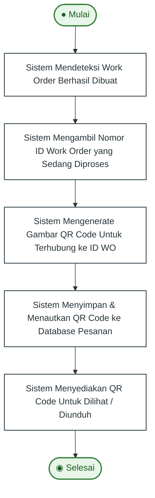

---

### 5.7 Activity Diagram: Membuat Nota Pembayaran

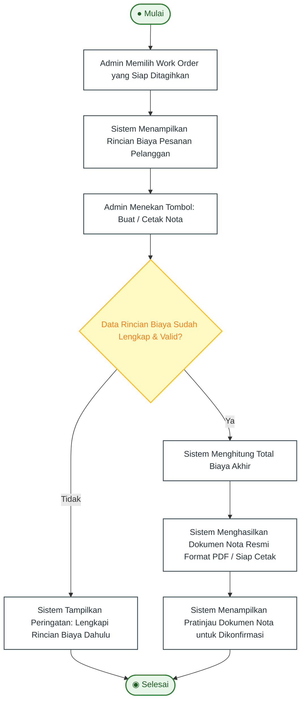

---

## 6. Kumpulan Sequence Diagram (Bab 3.2 SRS)

### 6.1 Sequence Diagram: Melakukan Login

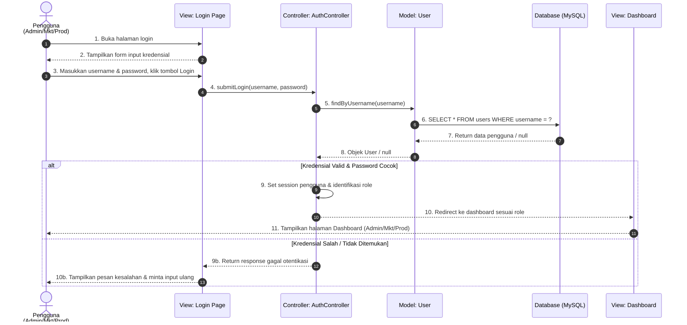

---

### 6.2 Sequence Diagram: Melakukan CRUD Work Order

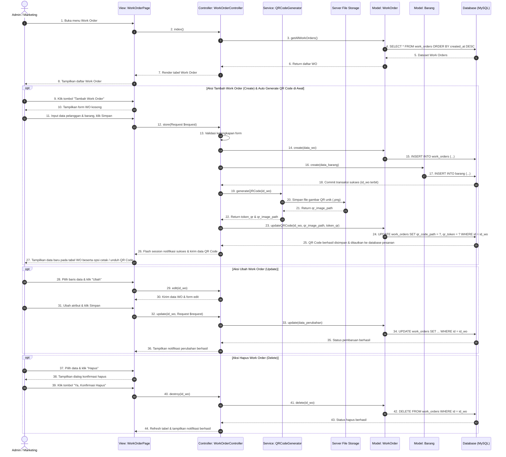

---

### 6.3 Sequence Diagram: Mengelola Progress

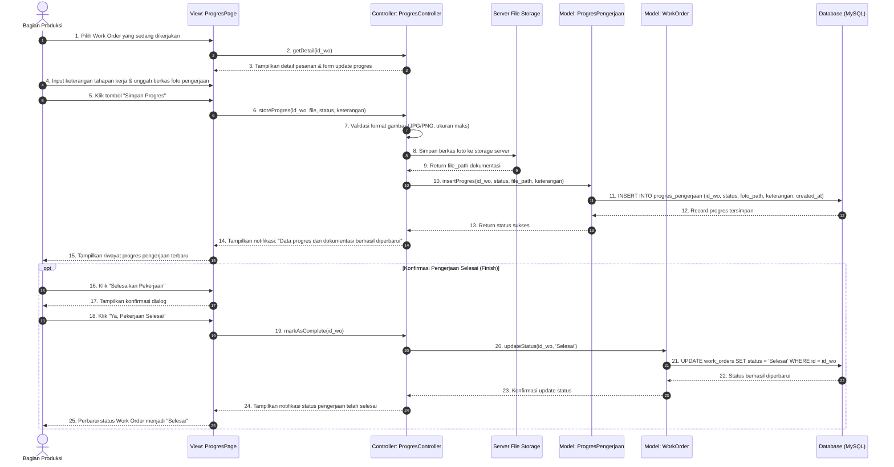

---

### 6.4 Sequence Diagram: Melihat Progress (Pelanggan)

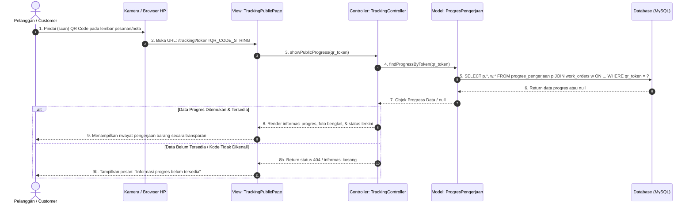

---

### 6.5 Sequence Diagram: Mencari Work Order

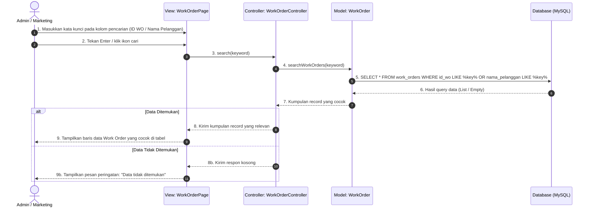

---

### 6.6 Sequence Diagram: Mengenerate QR Code (Inklusi Otomatis Work Order)

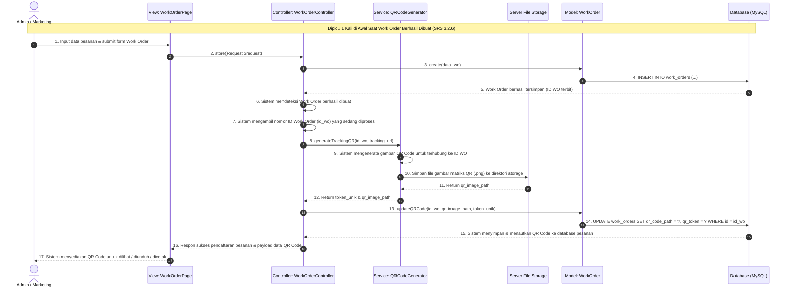

---

### 6.7 Sequence Diagram: Membuat Nota Pembayaran

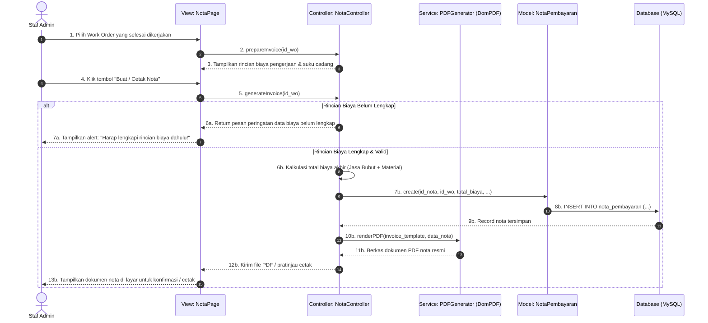
