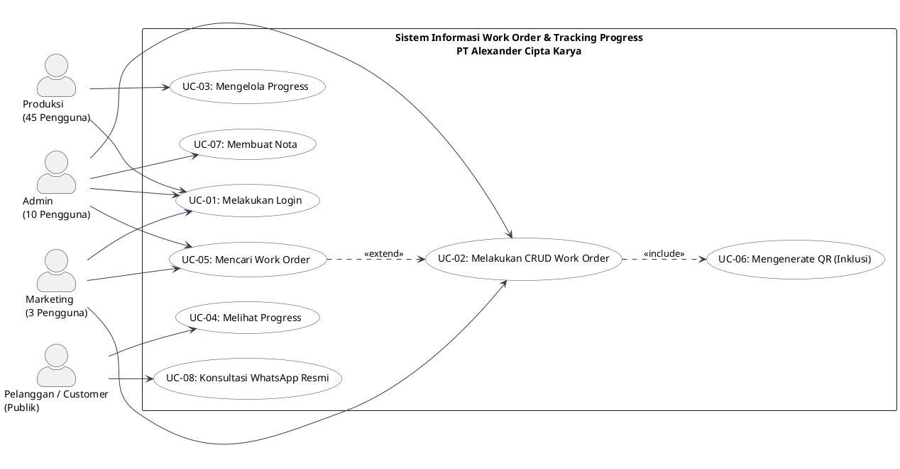
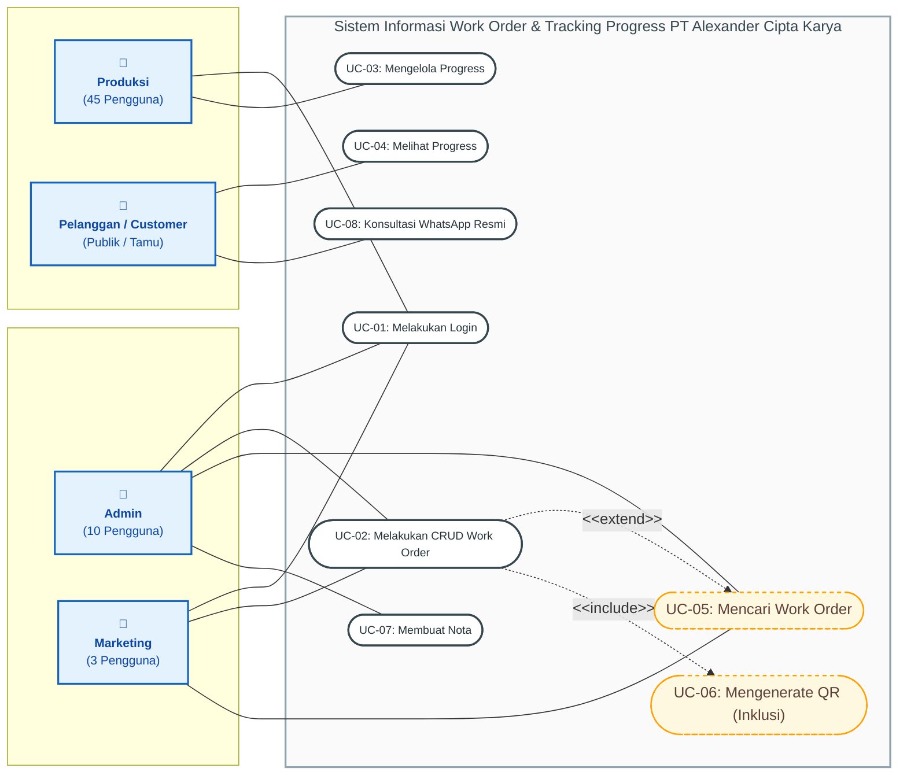

# 01. Use Case Diagram — Sistem Informasi PT Alexander Cipta Karya

Diagram Use Case ini memodelkan fungsionalitas sistem informasi Work Order dan Tracking Progress PT Alexander Cipta Karya (SRS-BUBUT) berdasarkan Bab 3.1, Bab 3.1.1, dan Bab 3.2 dokumen SRS.

---

## 🎯 Mengapa Stickman Sangat Penting di Use Case?
Secara standar UML, aktor dalam Use Case Diagram **wajib digambarkan dengan figur orang / stickman** (*stick figure*). 

Di **Draw.io**, Anda memiliki **2 Cara Terbaik** untuk memunculkan Stickman secara otomatis:
1. **Opsi 1 (Format PlantUML Draw.io - PALING DIREKOMENDASIKAN)**: Langsung menghasilkan bentuk objek Stickman vektor bawaan Draw.io 100% presisi.
2. **Opsi 2 (Format Mermaid `usecase-beta`)**: Sintaks resmi Mermaid terbaru khusus Use Case dengan keyword `actor` (menghasilkan stickman).
3. **Opsi 3 (Format Mermaid `flowchart` dengan Person Shape)**: Format flowchart alternatif.

---

## 🌟 OPSI 1: Kode PlantUML (Langsung Jadi Stickman Asli di Draw.io)
> **💡 Cara Pakai di Draw.io (Sangat Mudah):**
> 1. Buka [draw.io](https://app.diagrams.net/).
> 2. Klik menu **Arrange** > **Insert** > **Advanced** > **PlantUML**.
> 3. Salin (*copy*) kode di bawah ini dan tempel (*paste*), lalu klik **Insert**.
> 4. Seluruh aktor otomatis berwujud **Stickman (UML Actor)** lengkap dengan oval use case dan panah `<<include>>` / `<<extend>>`.



---

## 🌟 OPSI 2: Kode Mermaid Resmi Use Case (`usecase-beta` dengan Stickman)
> **💡 Cara Pakai di Draw.io:**
> 1. Buka [draw.io](https://app.diagrams.net/).
> 2. Klik menu **Arrange** > **Insert** > **Advanced** > **Mermaid**.
> 3. Salin kode di bawah ini dan klik **Insert**.

```mermaid
usecase-beta
    direction LR

    actor Admin("Admin")
    actor Marketing("Marketing")
    actor Produksi("Produksi")
    actor Customer("Pelanggan")

    systemBoundary "Sistem Informasi Work Order & Tracking Progress PT Alexander Cipta Karya"
        UC1("UC-01: Melakukan Login")
        UC2("UC-02: Melakukan CRUD Work Order")
        UC3("UC-03: Mengelola Progress")
        UC4("UC-04: Melihat Progress")
        UC5("UC-05: Mencari Work Order")
        UC6("UC-06: Mengenerate QR Code")
        UC7("UC-07: Membuat Nota")
        UC8("UC-08: Konsultasi WhatsApp")
    end

    Admin --> UC1
    Admin --> UC2
    Admin --> UC5
    Admin --> UC7

    Marketing --> UC1
    Marketing --> UC2
    Marketing --> UC5

    Produksi --> UC1
    Produksi --> UC3

    Customer --> UC4
    Customer --> UC8

    UC2 ..> : include UC6
    UC2 ..> : extend UC5
```

---

## 🌟 OPSI 3: Kode Mermaid Flowchart (Versi Visual dengan Ikon Stickman)
Jika Anda tetap ingin menggunakan format `flowchart` Mermaid:



---

## 💡 Trik Cepat Mengubah Box Menjadi Stickman Langsung di Draw.io:
Jika Anda sudah terlanjur mengimpor diagram berwujud kotak di Draw.io dan ingin mengubahnya menjadi Stickman dalam 2 detik:
1. Klik kotak aktor (misal kotak **Admin**).
2. Di toolbar sebelah kiri draw.io, cari kategori bentuk **UML**.
3. **Tarik (*drag*)** bentuk **Actor (Stickman)** dari panel kiri dan lepaskan tepat di atas kotak Admin yang ingin diganti, atau klik tombol **Edit Shape / Replace Shape** pada panel Format kanan.
4. Kotak seketika berubah menjadi stickman tanpa merusak garis penghubung (*connectors*).

---

## Matriks Pemetaan Use Case dan Aktor (Berdasarkan SRS 3.1.1)

| No | Nama Use Case | Admin | Marketing | Produksi | Pelanggan | Keterangan Hubungan |
|:--:|:---|:---:|:---:|:---:|:---:|:---|
| **UC-01** | Melakukan Login | **X** | **X** | **X** | - | Otentikasi hak akses sesuai peran (*role-based*) |
| **UC-02** | Melakukan CRUD Work Order | **X** | **X** | - | - | Buat, ubah, hapus, dan lihat data pesanan kerja (termasuk auto trigger QR di awal) |
| **UC-03** | Mengelola Progress | - | - | **X** | - | Update tahapan kerja & upload bukti foto dokumentasi |
| **UC-04** | Melihat Progress | - | - | - | **X** | Tracking langsung via QR Code / URL unik tanpa login |
| **UC-05** | Mencari Work Order | **X** | **X** | - | - | `<<extend>>` dari CRUD Work Order (pencarian kata kunci) |
| **UC-06** | Mengenerate QR (Inklusi) | - | - | - | - | `<<include>>` otomatis dipicu sistem 1 kali saat Work Order baru dibuat |
| **UC-07** | Membuat Nota | **X** | - | - | - | Khusus Admin setelah pekerjaan selesai / masuk tahap bayar |
| **UC-08** | Konsultasi WhatsApp | - | - | - | **X** | Tombol penghubung ke WA resmi perusahaan (FR-007) |
