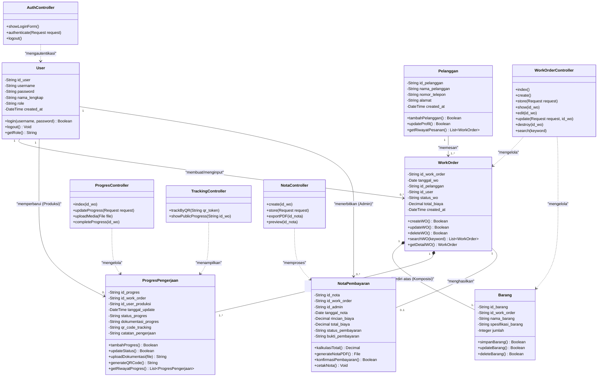

# 02. Class Diagram — Sistem Informasi PT Alexander Cipta Karya

Diagram Kelas (*Class Diagram*) ini memodelkan struktur berorientasi objek sistem berbasis arsitektur **MVC (Model-View-Controller)** pada kerangka kerja **Laravel (PHP)** sesuai dengan Bab 4.1 (Kebutuhan Data) dan Bab 4.4 (Kebutuhan Perangkat Lunak) pada dokumen SRS.

---

## 1. Kode Mermaid (Siap Di-import ke Draw.io)

> **Cara Import ke Draw.io:**
> 1. Buka [draw.io](https://app.diagrams.net/).
> 2. Klik menu **Arrange** > **Insert** > **Advanced** > **Mermaid**.
> 3. Salin (*copy*) kode di dalam blok di bawah ini dan tempel (*paste*) ke Draw.io.
> 4. Klik **Insert**.

---

## 2. Deskripsi Elemen dan Struktur Kelas

### A. Lapisan Model (Data Domain)

1. **`User`**:
   - Menyimpan akun petugas bengkel dengan atribut peran (`role`: Admin, Marketing, Produksi).
   - Menangani proses enkripsi password dan validasi autentikasi.

2. **`Pelanggan`**:
   - Menyimpan data identitas pelanggan (*Nama Pelanggan, Nomor Telepon, Alamat*).
   - Menghubungkan riwayat pesanan pelanggan ke berbagai dokumen *Work Order*.

3. **`WorkOrder`**:
   - Entitas sentral yang menyimpan instruksi pengerjaan jasa bubut/manufaktur.
   - Menyimpan status keseluruhan (misal: *Pending, In Progress, Ready for Billing, Completed*).

4. **`Barang`**:
   - Menyimpan detail teknis barang yang dikerjakan (*Nama Barang, Spesifikasi Barang/Ukuran/Bahan, Jumlah*).
   - Terikat langsung secara kuat (*Composition*) dengan `WorkOrder`.

5. **`ProgresPengerjaan`**:
   - Mencatat setiap pembaruan pengerjaan yang dilakukan operator bengkel bubut (Produksi).
   - Menyimpan tautan berkas foto dokumentasi (*file path*) dan kode unik pelacakan QR Code.

6. **`NotaPembayaran`**:
   - Dibuat oleh Admin ketika pekerjaan telah selesai atau masuk termin pembayaran.
   - Mengkalkulasi subtotal rincian biaya pesanan menjadi dokumen tagihan digital yang dapat diunduh (PDF) atau dicetak.

---

### B. Lapisan Controller (MVC Laravel)

- **`AuthController`**: Menangani otentikasi sesi login pengguna internal bengkel sesuai hak akses peran.
- **`WorkOrderController`**: Mengatur alur pembuatan, pengubahan, penghapusan, dan filter pencarian pesanan kerja.
- **`ProgresController`**: Memproses input tahapan pengerjaan dan penerimaan unggahan foto dokumentasi dari operator lapangan.
- **`TrackingController`**: Menangani permintaan publik dari pelanggan yang memindai QR Code untuk menampilkan status pengerjaan secara aman tanpa login.
- **`NotaController`**: Mengelola perhitungan tagihan, pembuatan nomor nota unik, dan konversi ke dokumen PDF.
