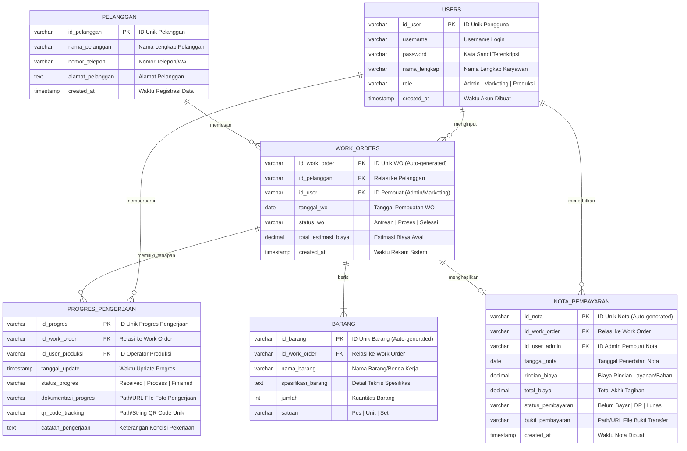

# 04. Entity Relationship Diagram (ERD) — Sistem Informasi PT Alexander Cipta Karya

Diagram Hubungan Entitas (*Entity Relationship Diagram* / ERD) ini memodelkan skema basis data fisik dan relasional sistem (*MySQL / MariaDB*) sesuai dengan Bab 4.1 (Kebutuhan Data) dan Bab 4.4 (Kebutuhan Perangkat Lunak) pada dokumen SRS.

---

## 1. Kode Mermaid (Siap Di-import ke Draw.io)

> **Cara Import ke Draw.io:**
> 1. Buka [draw.io](https://app.diagrams.net/).
> 2. Klik menu **Arrange** > **Insert** > **Advanced** > **Mermaid**.
> 3. Salin (*copy*) kode di dalam blok di bawah ini dan tempel (*paste*) ke Draw.io.
> 4. Klik **Insert**.

---

## 2. Kamus Data & Deskripsi Atribut (Data Dictionary)

Berdasarkan tabel Kebutuhan Data pada Bab 4.1 dokumen SRS:

### 1. Entitas `USERS` (Pengguna Sistem Internal)
- `id_user` (VARCHAR(20), PK): Nomor induk / kode identifikasi unik untuk setiap pegawai.
- `username` (VARCHAR(50), UNIQUE): Kredensial masuk ke sistem.
- `password` (VARCHAR(255)): Kata sandi yang diamankan menggunakan fungsi hash (misal: *bcrypt*).
- `nama_lengkap` (VARCHAR(100)): Nama staf bengkel yang bertugas.
- `role` (VARCHAR(20)): Hak akses peran: **Admin**, **Marketing**, atau **Produksi**.
- `created_at` (TIMESTAMP): Waktu akun dibuat di dalam sistem.

### 2. Entitas `PELANGGAN`
- `id_pelanggan` (VARCHAR(20), PK): Kode identifikasi pelanggan.
- `nama_pelanggan` (VARCHAR(100)): Nama perorangan atau nama perusahaan pemesan jasa bubut.
- `nomor_telepon` (VARCHAR(20)): Nomor telepon / WhatsApp aktif pelanggan.
- `alamat_pelanggan` (TEXT): Alamat fisik pelanggan.
- `created_at` (TIMESTAMP): Waktu rekaman dibuat.

### 3. Entitas `WORK_ORDERS` (Pesanan Kerja)
- `id_work_order` (VARCHAR(30), PK): Kode unik pesanan kerja yang digenerate otomatis oleh sistem (misal: `WO-2026-001`).
- `id_pelanggan` (VARCHAR(20), FK): Kunci tamu yang menghubungkan pesanan ke tabel `PELANGGAN`.
- `id_user` (VARCHAR(20), FK): Kunci tamu ke staf Admin/Marketing yang mencatat pesanan.
- `tanggal_wo` (DATE): Tanggal saat pesanan kerja didaftarkan.
- `status_wo` (VARCHAR(30)): Status keseluruhan (*Menunggu, Sedang Dikerjakan, Siap Diambil, Selesai*).
- `total_estimasi_biaya` (DECIMAL(12,2)): Estimasi biaya pengerjaan.

### 4. Entitas `BARANG` (Spesifikasi Benda Kerja)
- `id_barang` (VARCHAR(30), PK): Kode unik barang yang diproses (auto-generated).
- `id_work_order` (VARCHAR(30), FK): Kunci tamu ke dokumen pesanan induk.
- `nama_barang` (VARCHAR(100)): Nama komponen/benda kerja (misal: Poros Bubut, Gear Custom, Flange).
- `spesifikasi_barang` (TEXT): Rincian spesifikasi teknis barang (dimensi diameter, toleransi, jenis material besi/baja/kuningan).
- `jumlah` (INT): Jumlah fisik barang yang diproduksi.

### 5. Entitas `PROGRES_PENGERJAAN` (Pelacakan Tahapan Kerja)
- `id_progres` (VARCHAR(30), PK): Kode unik riwayat tahapan pengerjaan.
- `id_work_order` (VARCHAR(30), FK): Kunci tamu ke pesanan yang sedang diproses.
- `id_user_produksi` (VARCHAR(20), FK): Kunci tamu ke operator bagian produksi yang memperbarui status.
- `tanggal_update` (TIMESTAMP): Waktu riil saat status diperbarui.
- `status_progres` (VARCHAR(50)): Tahapan pekerjaan terkini (*Received / Process / Finished*).
- `dokumentasi_progres` (VARCHAR(255)): Alamat penyimpanan berkas foto atau dokumen pendukung.
- `qr_code_tracking` (VARCHAR(255)): String teks / tautan yang dienkode ke dalam gambar matriks QR Code.
- `catatan_pengerjaan` (TEXT): Keterangan tambahan dari operator bengkel.

### 6. Entitas `NOTA_PEMBAYARAN` (Faktur / Tagihan)
- `id_nota` (VARCHAR(30), PK): Kode unik faktur pembayaran (auto-generated, misal: `INV-2026-001`).
- `id_work_order` (VARCHAR(30), FK): Kunci tamu ke pesanan kerja yang telah selesai.
- `id_user_admin` (VARCHAR(20), FK): Kunci tamu ke staf Admin yang menerbitkan nota.
- `tanggal_nota` (DATE): Tanggal nota diterbitkan.
- `rincian_biaya` (DECIMAL(12,2)): Rincian biaya jasa pengerjaan dan bahan baku.
- `total_biaya` (DECIMAL(12,2)): Total nominal tagihan akhir.
- `status_pembayaran` (VARCHAR(30)): Status pelunasan (*Belum Bayar, Uang Muka / DP, Lunas*).
- `bukti_pembayaran` (VARCHAR(255)): Berkas unggahan bukti transfer pembayaran dari pelanggan.

---

## 3. Kardinalitas dan Aturan Bisnis (*Business Rules*)

1. **`PELANGGAN` ke `WORK_ORDERS` (1 ke Banyak / 1:N)**:
   - Satu orang pelanggan dapat memiliki satu atau banyak pesanan kerja (*Work Order*).
   - Suatu *Work Order* wajib dimiliki oleh tepat satu pelanggan.

2. **`WORK_ORDERS` ke `BARANG` (1 ke Banyak / 1:N - Komposisi)**:
   - Satu lembar *Work Order* dapat mencakup satu atau lebih benda kerja/barang yang akan dibubut.
   - Keberadaan data `BARANG` bergantung penuh pada `WORK_ORDERS`.

3. **`WORK_ORDERS` ke `PROGRES_PENGERJAAN` (1 ke Banyak / 1:N)**:
   - Satu *Work Order* memiliki riwayat progres pengerjaan bertahap dari awal hingga selesai (*timeline progress*).

4. **`WORK_ORDERS` ke `NOTA_PEMBAYARAN` (1 ke 0..1 / 1:1 Opsional)**:
   - Satu *Work Order* yang telah selesai atau mencapai termin tagihan akan diterbitkan tepat satu dokumen *Nota Pembayaran*.
