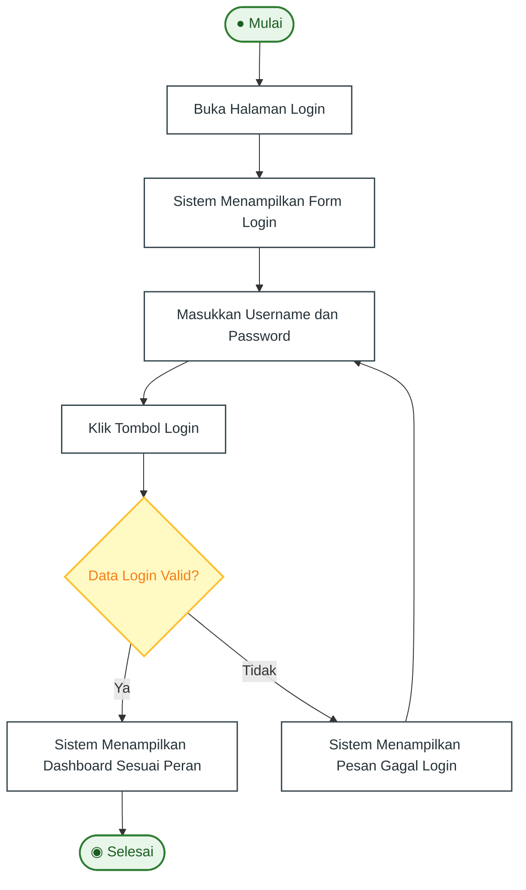
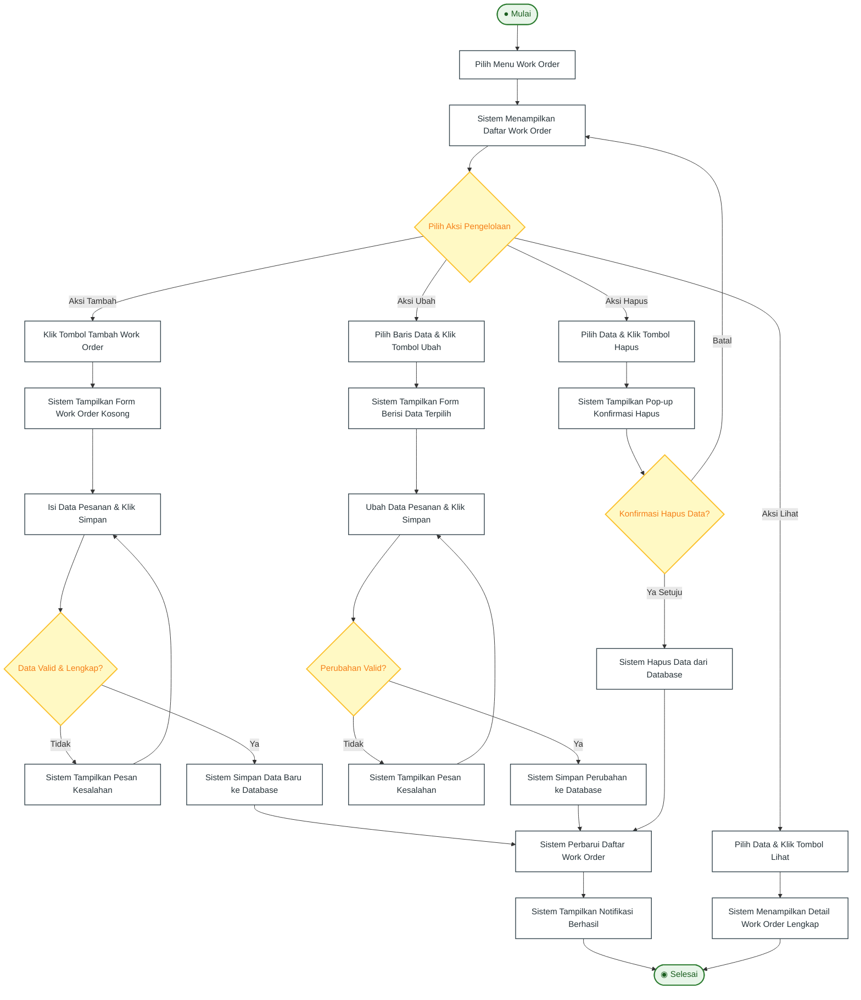
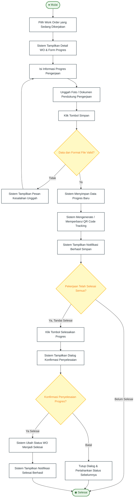
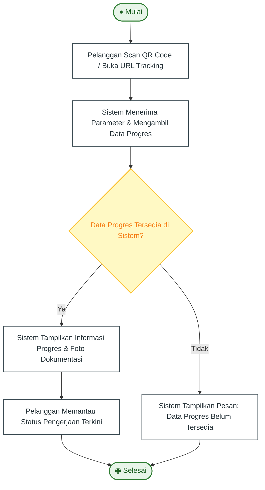
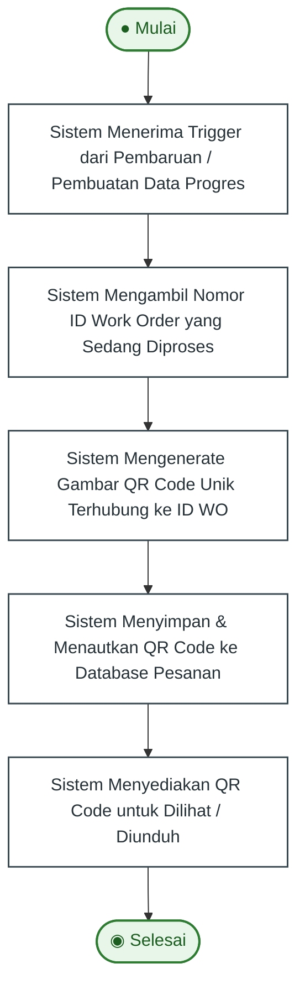
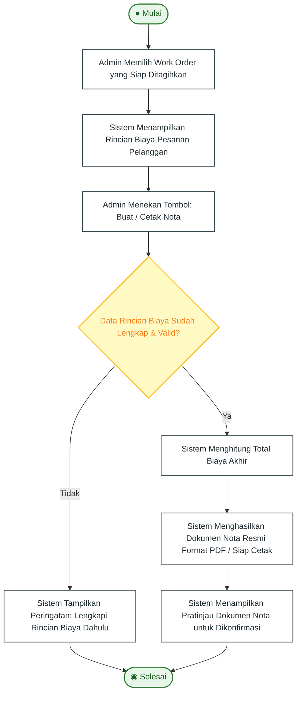

# 05. Activity Diagram — Sistem Informasi PT Alexander Cipta Karya

Dokumen ini memuat seluruh pemodelan alur kerja (*Activity Diagram*) sistem informasi PT Alexander Cipta Karya yang disusun berdasarkan Bab 3.3 dokumen SRS (SKPL-BUBUT halaman 33–40).

Terdapat 7 Activity Diagram lengkap:
1. **AD-01: Melakukan Login (3.3.1)**
2. **AD-02: Melakukan CRUD Work Order (3.3.2)**
3. **AD-03: Mengelola Progress (3.3.3)**
4. **AD-04: Melihat Progress / Pelanggan (3.3.4)**
5. **AD-05: Mencari Work Order (3.3.5)**
6. **AD-06: Mengenerate QR (Inklusi) (3.3.6)**
7. **AD-07: Membuat Nota (3.3.7)**

> **Tips Import ke Draw.io:**
> Anda dapat menyalin masing-masing blok kode Mermaid di bawah ini, lalu pada draw.io pilih **Arrange** > **Insert** > **Advanced** > **Mermaid** untuk mengimpor diagram yang diinginkan satu per satu. File satuan mandiri juga tersedia pada direktori `diagrams/activity/`.

---

## 1. AD-01: Melakukan Login (SRS 3.3.1)

Diagram aktivitas otentikasi pengguna internal (Admin, Marketing, Produksi) dengan validasi kredensial dan penanganan kondisi gagal (*alternative flow*).



---

## 2. AD-02: Melakukan CRUD Work Order (SRS 3.3.2)

Menggambarkan 4 cabang percabangan aksi pengelolaan Work Order oleh Admin/Marketing: Tambah, Ubah, Hapus, dan Lihat detail.



---

## 3. AD-03: Mengelola Progress (SRS 3.3.3)

Diagram aktivitas bagian Produksi dalam memperbarui progres pengerjaan barang, mengunggah bukti foto pengerjaan, otomatis memicu generate QR, dan menyelesaikan pesanan.



---

## 4. AD-04: Melihat Progress (Pelanggan) (SRS 3.3.4)

Diagram aktivitas pelanggan saat melacak status pesanan kerja secara mandiri melalui pemindaian QR Code tracking atau membuka URL pelacakan.



---

## 5. AD-05: Mencari Work Order (SRS 3.3.5)

Diagram aktivitas pencarian cepat data Work Order oleh Admin atau Marketing menggunakan kata kunci tertentu.

```mermaid
flowchart TD
    Start([● Mulai]) --> A1[Masukkan Kata Kunci Pencarian Pada Kolom Input<br/>(Contoh: ID Work Order / Nama Pelanggan)]
    A1 --> S1[Sistem Memfilter Data Work Order Sesuai Kata Kunci]
    S1 --> S2{Data Sesuai Ditemukan?}
    
    S2 -->|Ya| S3[Sistem Menampilkan Daftar Hasil Pencarian yang Relevan]
    S3 --> EndNode([◉ Selesai])
    
    S2 -->|Tidak| S4[Sistem Menampilkan Pesan Peringatan: Data Tidak Ditemukan]
    S4 --> EndNode

    classDef startEnd fill:#E8F5E9,stroke:#2E7D32,stroke-width:2px,color:#1B5E20;
    classDef action fill:#FFFFFF,stroke:#37474F,stroke-width:1.5px,color:#263238;
    classDef decision fill:#FFF9C4,stroke:#FBC02D,stroke-width:2px,color:#F57F17;
    
    class Start,EndNode startEnd;
    class A1,S1,S3,S4 action;
    class S2 decision;
```

---

## 6. AD-06: Mengenerate QR (Inklusi Otomatis) (SRS 3.3.6)

Diagram alur proses otomatis sistem (*sub-process / include*) dalam menciptakan kode batang 2D (QR Code) unik yang ditautkan ke ID Work Order.



---

## 7. AD-07: Membuat Nota Pembayaran (SRS 3.3.7)

Diagram aktivitas Admin dalam memeriksa kelengkapan rincian biaya pengerjaan bubut, melakukan perhitungan total kalkulasi, dan mencetak dokumen tagihan resmi (*invoice* PDF).


