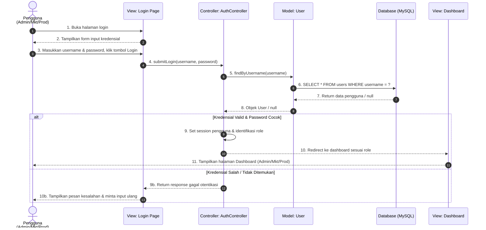
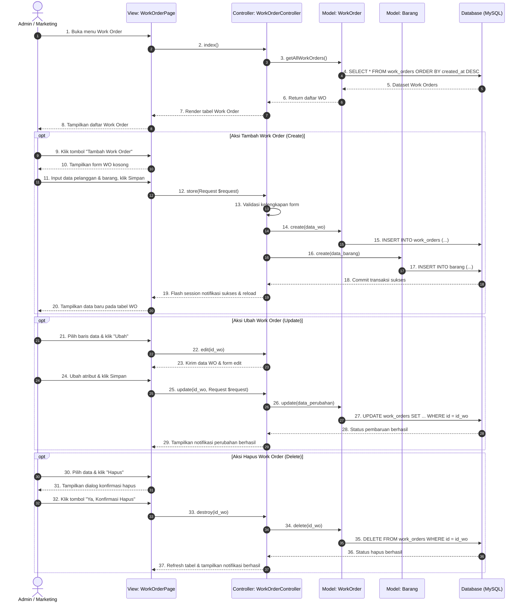
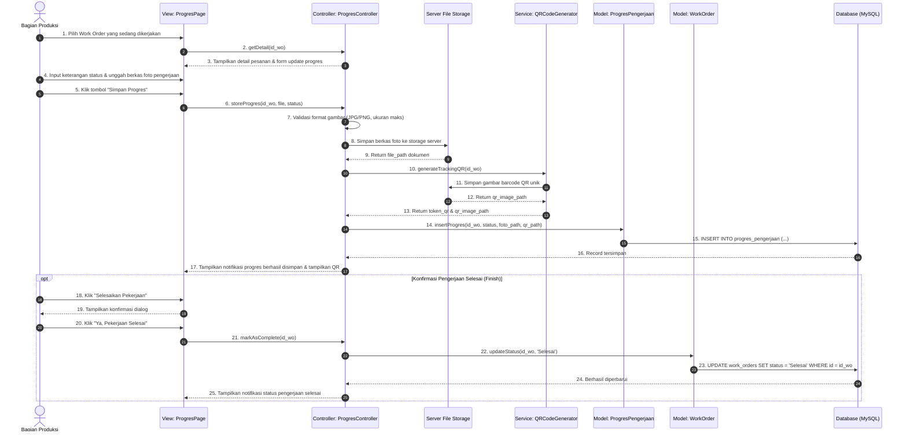
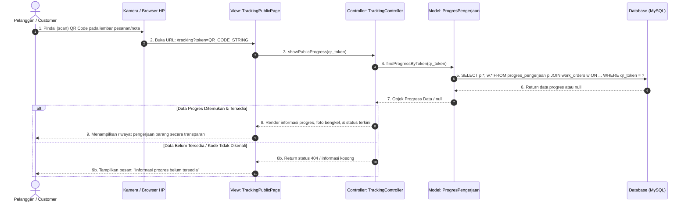
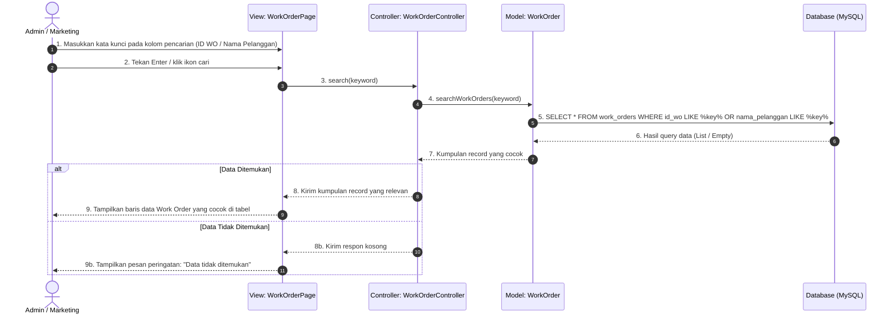
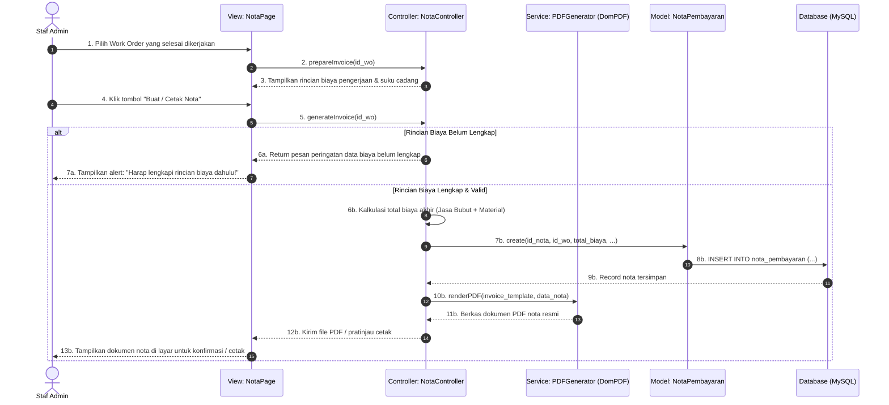

# 06. Sequence Diagram — Sistem Informasi PT Alexander Cipta Karya

Dokumen ini memuat seluruh pemodelan interaksi antar objek (*Sequence Diagram*) sistem informasi PT Alexander Cipta Karya yang dirancang berdasarkan skenario utama (*main flow*) dan skenario eksepsional (*alternative flow*) pada Bab 3.2 dokumen SRS (SKPL-BUBUT halaman 18–32), diimplementasikan dalam arsitektur **MVC Laravel + Database MySQL**.

Terdapat 6 Sequence Diagram lengkap:
1. **SD-01: Melakukan Login (SRS 3.2.1)**
2. **SD-02: Melakukan CRUD Work Order (SRS 3.2.2)**
3. **SD-03: Mengelola Progress & Auto Generate QR (SRS 3.2.3 & 3.2.6)**
4. **SD-04: Melihat Progress / Pelanggan Tracking (SRS 3.2.4)**
5. **SD-05: Mencari Work Order (SRS 3.2.5)**
6. **SD-06: Membuat Nota Pembayaran (SRS 3.2.7)**

> **Tips Import ke Draw.io:**
> Salin masing-masing blok kode Mermaid di bawah ini, lalu pada draw.io pilih menu **Arrange** > **Insert** > **Advanced** > **Mermaid**. File satuan mandiri juga tersedia di direktori `diagrams/sequence/`.

---

## 1. SD-01: Melakukan Login (SRS 3.2.1)

Memodelkan aliran autentikasi peran (*role-based*) untuk Admin, Marketing, dan Produksi, mencakup skenario berhasil dan gagal.

---

## 2. SD-02: Melakukan CRUD Work Order (SRS 3.2.2)

Memodelkan siklus hidup Work Order oleh Admin/Marketing yang mencakup penambahan (*Create*), penampilan detail (*Read*), pengubahan (*Update*), dan penghapusan (*Delete*).

---

## 3. SD-03: Mengelola Progress & Auto Generate QR Code (SRS 3.2.3 & 3.2.6)

Memodelkan pembaruan tahapan pengerjaan oleh tim Produksi, penyimpanan dokumen bukti foto, otomatisasi pembuatan QR Code pelacakan, serta penyelesaian status pengerjaan.

---

## 4. SD-04: Melihat Progress (Pelanggan / Tracking Mandiri) (SRS 3.2.4)

Memodelkan pelacakan mandiri oleh pelanggan menggunakan pemindaian QR Code tracking kamera ponsel tanpa perlu melakukan login kredensial.

---

## 5. SD-05: Mencari Work Order (SRS 3.2.5)

Memodelkan proses pencarian data pesanan secara cepat menggunakan nomor ID Work Order atau Nama Pelanggan.

---

## 6. SD-06: Membuat Nota Pembayaran (SRS 3.2.7)

Memodelkan pemeriksaan kelengkapan biaya oleh Admin, kalkulasi tagihan total, pembentukan berkas PDF nota, dan pencetakan dokumen resmi.

