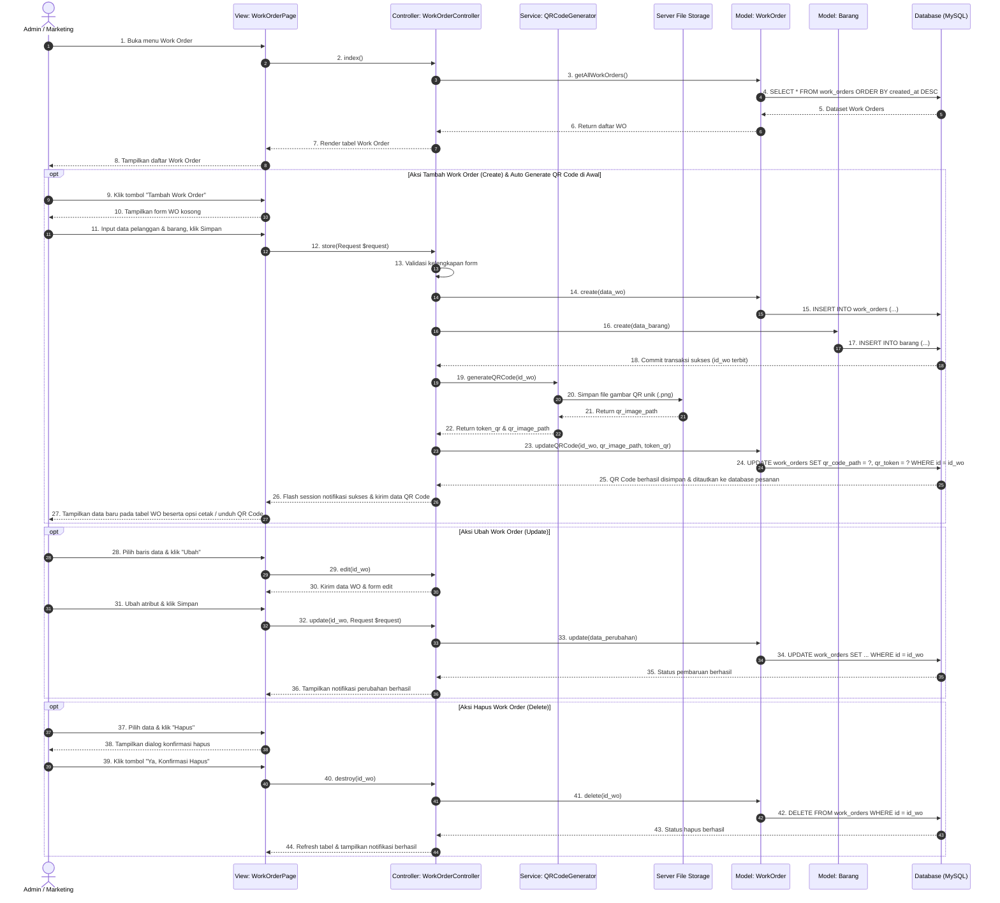

# Sequence Diagram: Melakukan CRUD Work Order & Auto Generate QR di Awal (SRS 3.2.2 & 3.2.6)

> **Catatan Alur:** Diagram ini memodelkan siklus hidup Work Order oleh Admin/Marketing. Saat Work Order baru dibuat (*Create*), sistem secara otomatis mengenerate QR Code pelacakan **1 kali di awal**, menautkannya ke database pesanan, dan menyediakannya untuk dilihat, diunduh, atau dicetak pada lembar kerja/nota.

