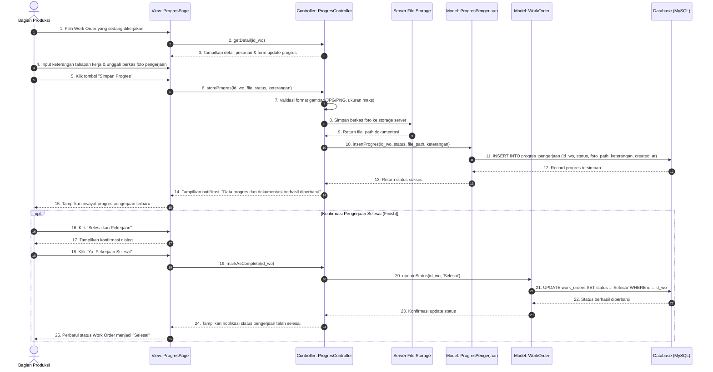

# Sequence Diagram: Mengelola Progress (SRS 3.2.3)

> **Catatan Alur:** Proses update progres oleh Bagian Produksi **hanya memperbarui data status dan mengunggah dokumentasi pengerjaan**, tidak mengenerate QR Code baru (QR Code pelacakan telah digenerate 1 kali di awal saat Work Order pertama kali dibuat).

