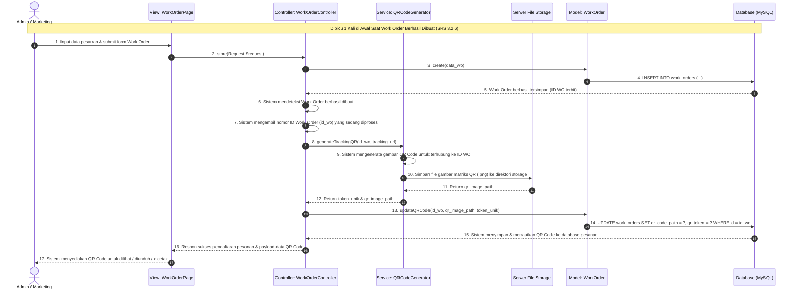

# Sequence Diagram: Mengenerate QR Code (SRS 3.2.6 - Inklusi Otomatis Work Order)

Diagram ini memodelkan fungsi inklusi otomatis sistem (*include*) yang dipicu **1 kali di awal** saat pembuatan data Work Order baru berhasil dilakukan, sebagaimana dimodelkan pada diagram alur Draw.io (Sistem mendeteksi Work Order berhasil dibuat -> Ambil ID WO -> Generate Gambar QR Code -> Simpan & tautkan ke database -> Sediakan untuk dilihat/diunduh).

